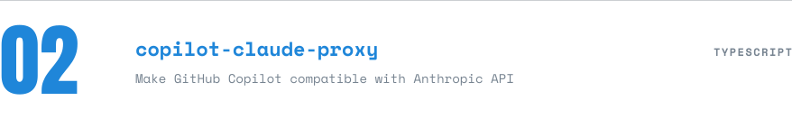
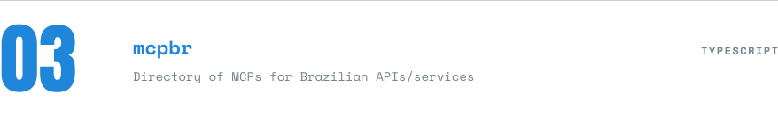
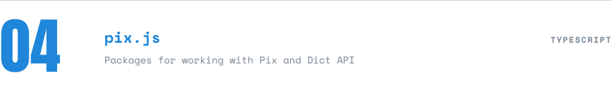
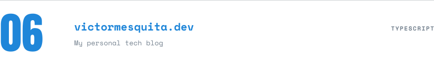

<picture>
  <source media="(prefers-color-scheme: dark)" srcset="assets/poster-dark.svg">
  
</picture>

  

<picture>
  <source media="(prefers-color-scheme: dark)" srcset="assets/label-01-dark.svg">
  
</picture>

 

<picture>
  <source media="(prefers-color-scheme: dark)" srcset="assets/label-02-dark.svg">
  
</picture>

- AI-assisted developer tooling (Copilot, MCPs, “developer experience” automation)
- Web automation and testing
- Fast systems (Rust) and pragmatic backends

 

<picture>
  <source media="(prefers-color-scheme: dark)" srcset="assets/label-03-dark.svg">
  
</picture>

TypeScript&ensp;/&ensp;Node.js&ensp;/&ensp;Rust&ensp;/&ensp;Python&ensp;/&ensp;PHP&ensp;/&ensp;.NET&ensp;/&ensp;PostgreSQL

 

<picture>
  <source media="(prefers-color-scheme: dark)" srcset="assets/label-04-dark.svg">
  
</picture>

I also keep a lot of explorations, forks, and spikes around: Solana tooling (Rust/TypeScript), UI kits and design systems (Next.js/TypeScript), and DevOps/self-hosting experiments.

 

<picture>
  <source media="(prefers-color-scheme: dark)" srcset="assets/label-05-dark.svg">
  
</picture>

[victormesquita.dev](https://victormesquita.dev)&emsp;[x.com/engineerdesoft](https://x.com/engineerdesoft)
