<picture>
  <source media="(prefers-color-scheme: dark)" srcset="assets/hero-dark.svg">
  
</picture>

## Select a level

<a href="https://github.com/victor-teles/playwright-php">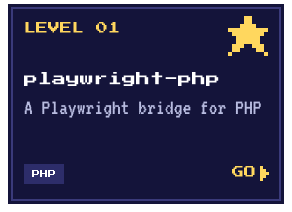</a><a href="https://github.com/victor-teles/copilot-claude-proxy">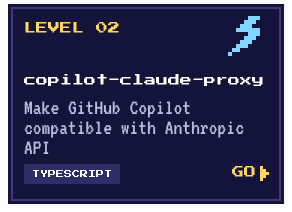</a><a href="https://github.com/victor-teles/mcpbr">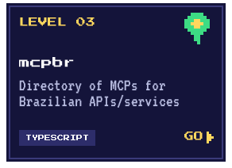</a>

<a href="https://github.com/victor-teles/pix.js">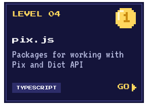</a><a href="https://github.com/victor-teles/AspNetCore.Pulse">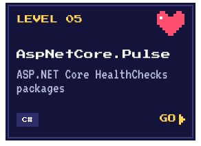</a><a href="https://github.com/victor-teles/victormesquita.dev">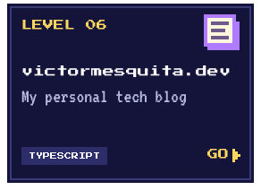</a>

<picture>
  <source media="(prefers-color-scheme: dark)" srcset="assets/quests-dark.svg">
  
</picture>

<picture>
  <source media="(prefers-color-scheme: dark)" srcset="assets/inventory-dark.svg">
  
</picture>

<picture>
  <source media="(prefers-color-scheme: dark)" srcset="assets/side-dark.svg">
  
</picture>

<picture>
  <source media="(prefers-color-scheme: dark)" srcset="assets/continue-dark.svg">
  
</picture>

[▶ victormesquita.dev](https://victormesquita.dev) &nbsp; [▶ x.com/engineerdesoft](https://x.com/engineerdesoft)
